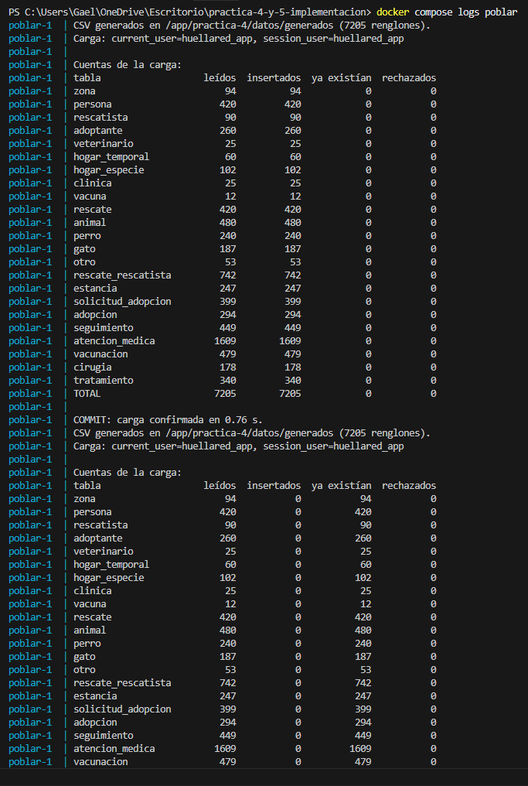
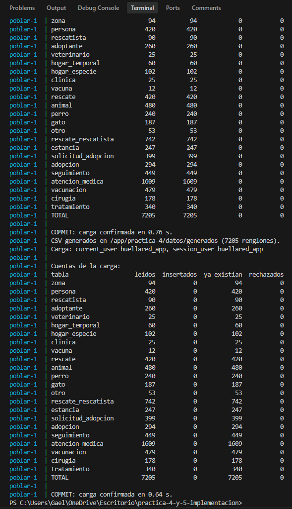
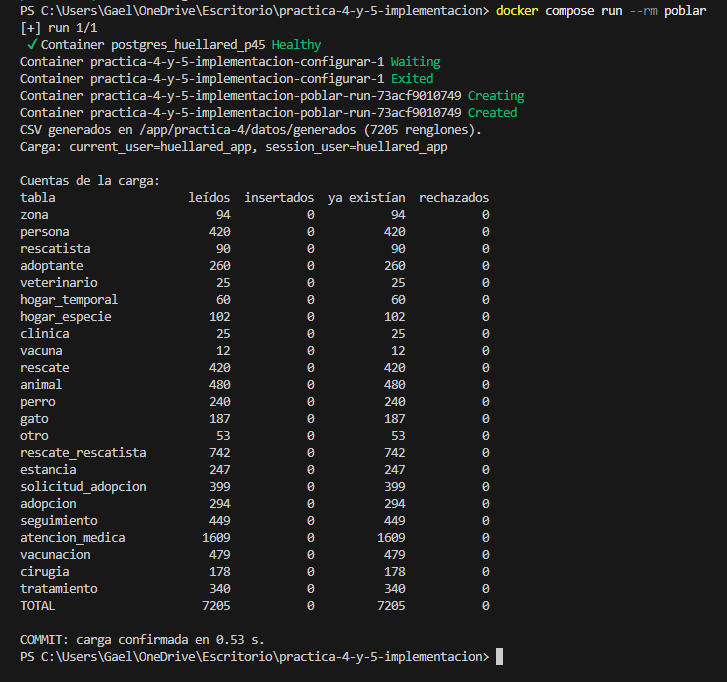
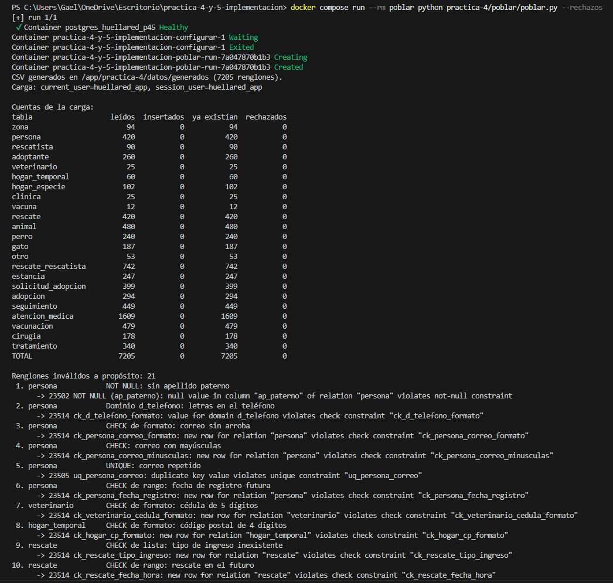
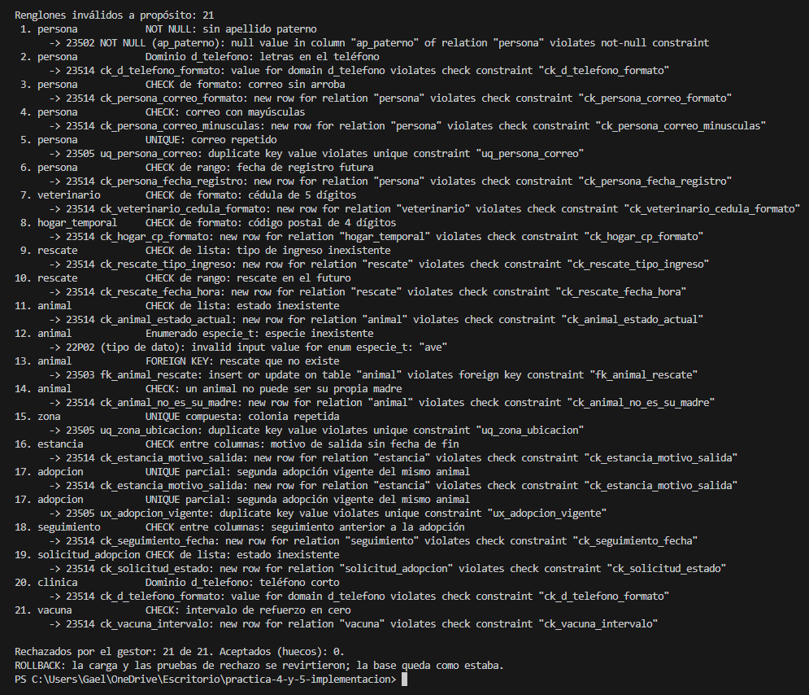
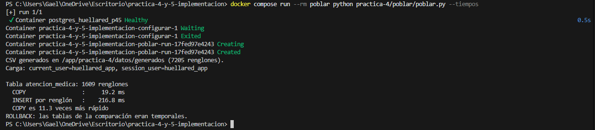

# INSTITUTO POLITÉCNICO NACIONAL
## ESCUELA SUPERIOR DE CÓMPUTO
## BASES DE DATOS
## GRUP: 3BV1
# HuellaRed — Prácticas 4 y 5

Base PostgreSQL 17 para rescate, cuidado y adopción de animales. Los datos del generador son **sintéticos**; la búsqueda de fuentes y su justificación están en `practica-4/fuente.md`.

## Arranque con un comando

Completar `.env` a partir de `.env.example` (incluidas las tres contraseñas HUELLARED) y ejecutar desde la raíz:

```powershell
docker compose up -d
```

Docker construye la imagen Python e instala las dependencias. PostgreSQL conserva los datos en `./data`; `configurar` espera al servidor, prepara el esquema y la migración y configura roles. Después `poblar` genera y carga los CSV como `huellared_app`. El host interno es `postgres:5432`; POSTGRES_PORT en `.env` solo publica el puerto para pgAdmin.

El comando inicia el proceso en segundo plano: su retorno no significa que la carga haya terminado. Comprobar:

```powershell
docker compose ps -a
docker compose logs configurar poblar
```

El resultado esperado es PostgreSQL saludable y ambos servicios auxiliares con `Exited (0)`, con el COMMIT de la carga en los logs. Un error de configuración impide iniciar la carga. Las pruebas se ejecutan aparte.

El esquema y 001 se registran con su huella en `huellared_control.migraciones`. También se reconoce la instalación anterior de este proyecto (tablas y restricciones presentes). No es una auditoría completa de esquemas modificados manualmente. No editar migraciones ya registradas: los cambios nuevos requieren otra migración y su incorporación al inicializador. No borrar `data` para actualizar el proyecto.

Después de modificar el código, reconstruir con `docker compose up -d --build`. Para repetir explícitamente la carga:

```powershell
docker compose run --rm poblar
```

Los CSV del arranque se generan dentro del contenedor y se pueden regenerar con la misma semilla. Para ejecutar Python directamente en la PC, instalar `python -m pip install -r requirements.txt`; las instrucciones siguientes corresponden a esa alternativa.

## Carga de datos — ejercicio 1.4

Desde la raíz del repositorio, el siguiente comando genera los CSV si no existen y carga las 23 tablas como `huellared_app`:

```powershell
python -m dotenv -f .env run -- python practica-4/poblar/poblar.py
```

Repetir el mismo comando para demostrar que no duplica registros. La carga usa una transacción, COPY a tablas temporales e inserciones en orden de dependencias. Los identificadores son deterministas y se asignan en el generador. ON CONFLICT sobre la PK conserva filas existentes: no actualiza su contenido ni comprueba que sea idéntico al CSV. Usar una base dedicada a estos datos.

Los CSV se guardan en `practica-4/datos/generados/`. `--regenerar` reconstruye los archivos, pero no borra ni reemplaza registros existentes en la base. `cargar.py` proporciona la conexión de aplicación y sigue disponible para cargar un SQL; `poblar.py` es la entrada del ejercicio 1.4.

## Resultados de ejecución

Se comprobaron el arranque con Compose, 7,205 inserciones en la primera carga, cero inserciones en la segunda, los mínimos de las cinco tablas principales, 21 rechazos esperados y la reversión completa ante un error. Las capturas se presentan agrupadas por ejecución. Las cifras corresponden a la versión revisada del generador.

Opciones disponibles para la etapa de pruebas:

```powershell
python -m dotenv -f .env run -- python practica-4/seguridad/probar.py
python -m dotenv -f .env run -- python practica-4/poblar/poblar.py --rechazos evidencias/rechazos-carga.md
python -m dotenv -f .env run -- python practica-4/poblar/poblar.py --tiempos
```

`--rechazos` carga y ensaya los casos inválidos dentro de una transacción que revierte al final. Su reporte muestra la restricción efectiva: revisar que coincida con la que se pretendía probar y explicar cada rechazo. Si un caso inválido es aceptado, el programa termina con error después de revertir. `--tiempos` compara COPY e INSERT por fila en tablas temporales; no representa el tiempo total de la carga con todas sus restricciones.

## Organización

- `practica-4/datos/generar_datos.py`: generación determinista de CSV y casos inválidos.
- `practica-4/poblar/`: conexión y carga.
- `practica-4/seguridad/`: configuración y pruebas de permisos.
- `practica-4/migraciones/`: cambios posteriores al esquema inicial.
- `practica-5/referencias.md`: claves foráneas y acciones referenciales.
- `evidencias/`: resultados y capturas de ejecuciones reales.

## Práctica 5: flujo de ejecución

Después del arranque y la carga, conectar pgAdmin como huellared_admin a HuellaRed:

1. Revisar `practica-5/referencias.md` (2.1 y 2.2).
2. Ejecutar `practica-5/sql/2.3-pruebas-referenciales.sql`; leer resultados en Data Output y errores esperados en Messages.
3. Ejecutar `practica-5/sql/2.3-auditoria-integridad.sql` en HuellaRed y, por separado, en la base asignada con su administrador. La consulta de infracciones debe devolver cero filas.
4. Ejecutar `practica-5/sql/2.4-edicion-valores.sql` completo. Incluye un COMMIT real de datos auxiliares y su limpieza posterior.

La explicación, reglas y resultados están en `practica-5/pruebas-referenciales.md` y `practica-5/edicion-de-valores.md`, con los mismos SQL en bloques. Estas demostraciones son manuales y no forman parte del arranque automático. El análisis del almacén asignado (2.5) y el trabajo individual (2.6) son entregables separados.

El trabajo individual de Alejandro (2.6) compara `RESTRICT` y `CASCADE` en la relación entre persona y hogar temporal. El [informe de Alejandro](practica-5/integrantes/alejandro-rojas.md) y su [script SQL](practica-5/integrantes/alejandro-rojas.sql) documentan el experimento sobre una copia de la base.

El trabajo individual de Gael (2.6) compara `SET NULL` y `CASCADE` en la relación madre-cría de `animal`, sobre una copia de la base. El [informe con resultados y capturas](practica-5/integrantes/GaelZamudio.md) y el [script por bloques para pgAdmin](practica-5/integrantes/GaelZamudio.sql) documentan la prueba; no forman parte del arranque automático.

## Evidencias de ejecución

### Primera carga

Las dos imágenes consecutivas forman la salida de consola: incluyen la inserción de 7,205 registros y la continuación del historial de ejecución.





### Segunda carga

La repetición conserva 7,205 registros existentes, inserta cero y confirma la transacción.



### Rechazos de datos inválidos

Las dos partes muestran una misma ejecución: preparación, errores de los 21 casos y ROLLBACK final.





### Comparación de tiempos

La captura compara COPY e INSERT por fila para 1,609 atenciones en tablas temporales: 19.2 ms frente a 216.8 ms. Es una medición de esa ejecución, no una garantía de rendimiento.



Las evidencias de permisos están en [permisos.md](practica-4/permisos.md); las de integridad referencial en [pruebas-referenciales.md](practica-5/pruebas-referenciales.md), y las de edición y transacciones en [edicion-de-valores.md](practica-5/edicion-de-valores.md).
