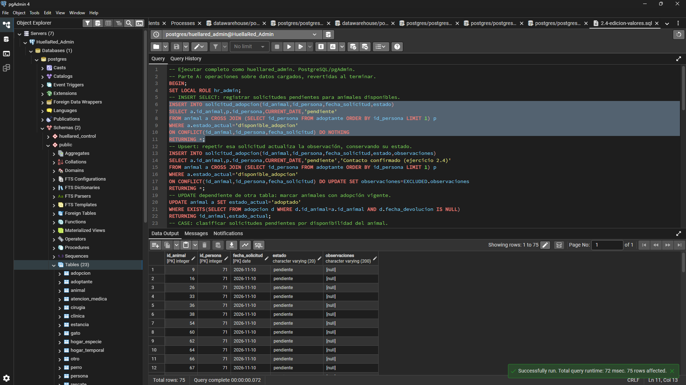
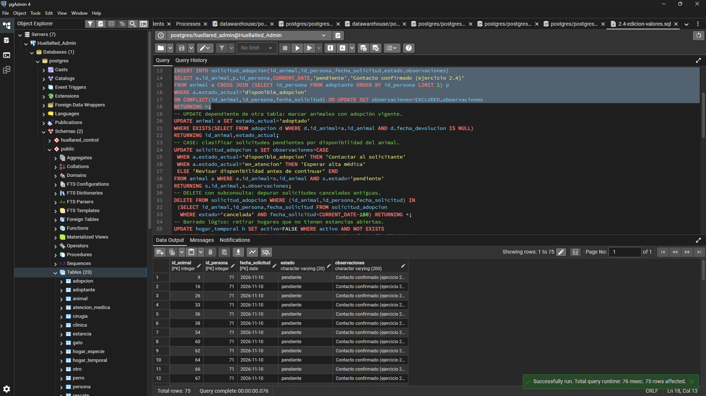
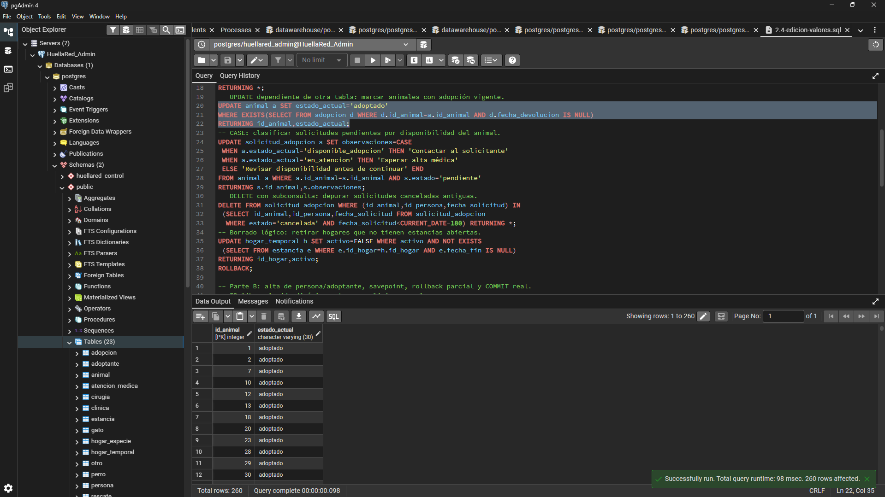
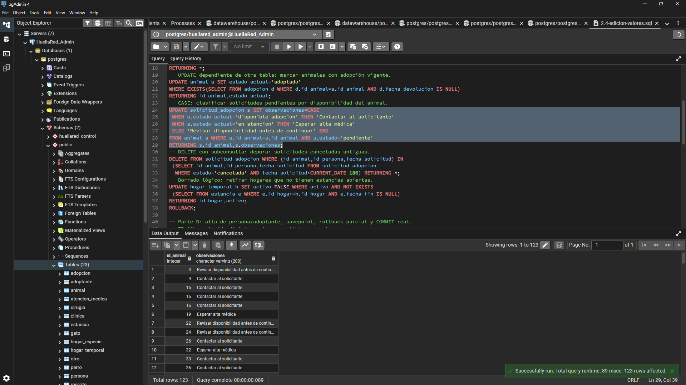
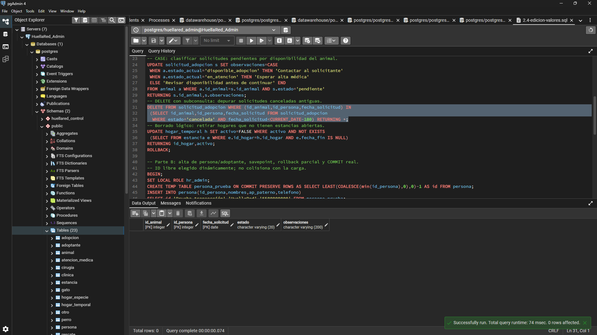
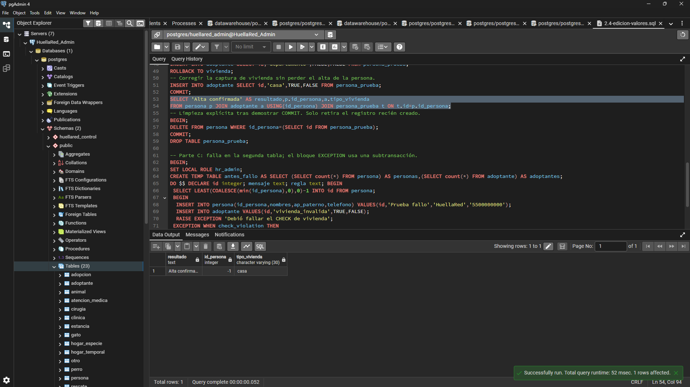
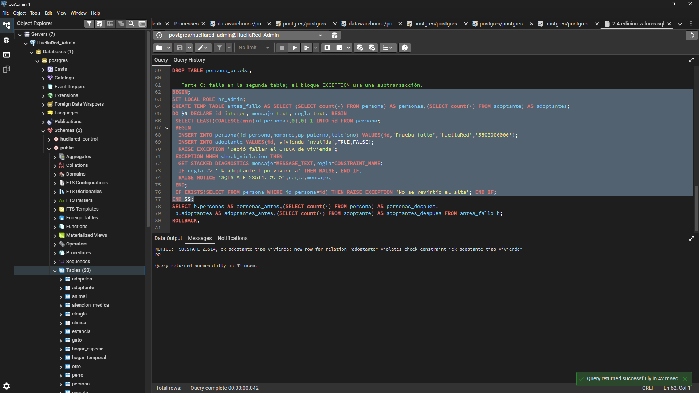
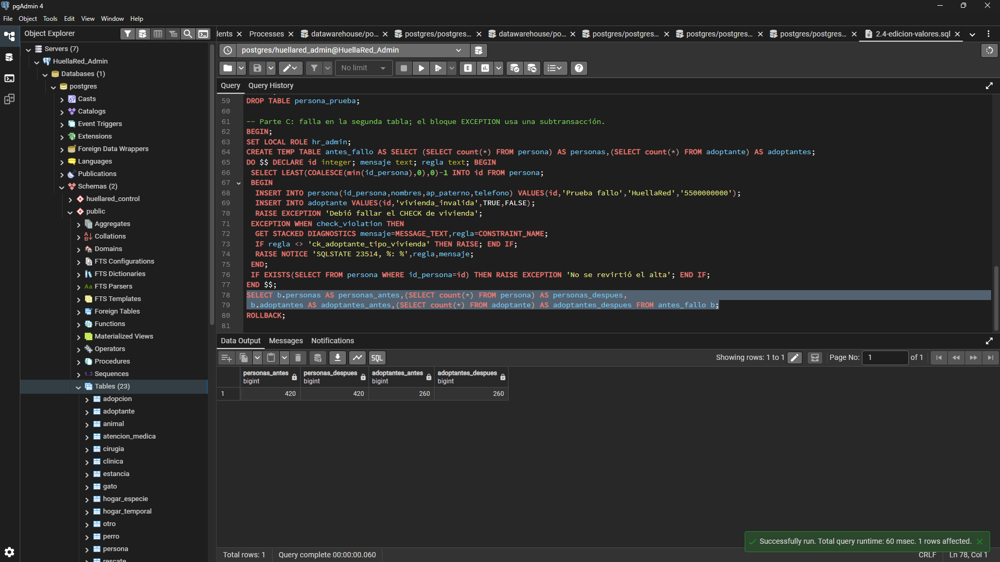

# Edición de valores y transacciones — HuellaRed

Ejercicio 2.4 · PostgreSQL 17.

## Ejecución

Con HuellaRed poblada, abrir `sql/2.4-edicion-valores.sql` en pgAdmin y ejecutar como `huellared_admin`. Este usuario puede demostrar la limpieza con DELETE y las acciones referenciales; el cargador continúa usando huellared_app. Ejecutar el archivo completo, fuera de otra transacción. Si ocurre un error inesperado, ejecutar ROLLBACK y revisar antes de repetir.

La parte A revierte sus operaciones al final. La parte B realiza un COMMIT real del alta de una persona y su subtipo adoptante, muestra lo confirmado y elimina expresamente esos registros de prueba en otra transacción. Si se interrumpe después del COMMIT, ese registro permanece: terminar la sección de limpieza en la misma sesión. La tabla temporal persona_prueba conserva el ID para retirarlo sin afectar otros registros. Usar una copia para la demostración de clase y evitar escrituras concurrentes durante el ejercicio.

## Operaciones y reglas del dominio

| Requisito | Situación y solución |
|---|---|
| INSERT SELECT | Registrar solicitudes pendientes para animales disponibles usando un adoptante existente. |
| Inserción si ya existe | Repetir las mismas solicitudes con ON CONFLICT actualiza su observación, conservando el estado previo. |
| UPDATE dependiente de otra tabla | Marcar como adoptados los animales que tienen una adopción vigente. |
| UPDATE con CASE | Clasificar las solicitudes pendientes según la disponibilidad del animal. |
| DELETE con subconsulta | Depurar solicitudes canceladas de más de 180 días. Se pierde el historial de esas solicitudes; es apropiado solo bajo esa política de depuración. No elimina animales ni adoptantes: son padres de la solicitud. |
| Borrado lógico | Desactivar hogares sin estancias abiertas. Se conservan dirección, responsable y estancias históricas. Borrarlos físicamente podría ser rechazado por fk_estancia_hogar. |
| Transacción con SAVEPOINT | Crear persona y adoptante; revertir una captura de vivienda y reemplazarla antes de confirmar ambos registros. |
| Falla a mitad | Insertar persona y luego un adoptante con vivienda inválida. El CHECK hace fallar la segunda operación; el bloque EXCEPTION revierte ambas escrituras. |

## Resultados comprobados

En la ejecución de validación se insertaron 75 solicitudes; el upsert devolvió las mismas 75. El UPDATE por adopción vigente alcanzó 260 animales; CASE clasificó 123 solicitudes. La depuración devolvió 17 solicitudes y el borrado lógico alcanzó 16 hogares. Estos valores dependen de los datos y de CURRENT_DATE, especialmente el corte de 180 días.

El alta confirmada quedó con vivienda `casa`, demostrando que la captura inicial de `departamento` se revirtió sin perder la persona. La limpieza posterior retiró el registro auxiliar.

En el caso fallido, el mensaje real fue:

```text
SQLSTATE 23514, ck_adoptante_tipo_vivienda: new row for relation "adoptante" violates check constraint "ck_adoptante_tipo_vivienda"
```

Los conteos permanecieron en 420 personas y 260 adoptantes; además, el bloque comprueba que no existe la persona parcialmente insertada. EXCEPTION crea una subtransacción de PostgreSQL: ambas inserciones están dentro de ella y se revierten juntas al capturar el error. El ROLLBACK exterior termina la demostración. No se confirma la persona aislada.

Una comparación del contenido completo de las tablas antes y después de ejecutar el archivo confirmó que la base conservó sus datos iniciales.

## Evidencias de ejecución

### INSERT SELECT y resolución de conflictos

La primera operación genera solicitudes; la repetición actualiza sus observaciones mediante ON CONFLICT.





### Actualización mediante relación y CASE

Las capturas muestran los animales con adopción vigente y las solicitudes clasificadas según disponibilidad.





### DELETE con subconsulta

En esta captura la sentencia termina correctamente con cero filas afectadas. Ese resultado corresponde a esta ejecución y no acredita las 17 eliminaciones observadas en la validación previa.



### SAVEPOINT y COMMIT

El resultado confirmado muestra vivienda casa después de revertir la captura inicial de departamento.



### Fallo y reversión

El mensaje del CHECK y los conteos antes/después documentan la reversión del alta incompleta.





## SQL: 2.4-edicion-valores.sql

```sql
-- Ejecutar completo como huellared_admin. PostgreSQL/pgAdmin.
-- Parte A: operaciones sobre datos cargados, revertidas al terminar.
BEGIN;
SET LOCAL ROLE hr_admin;
-- INSERT SELECT: registrar solicitudes pendientes para animales disponibles.
INSERT INTO solicitud_adopcion(id_animal,id_persona,fecha_solicitud,estado)
SELECT a.id_animal,p.id_persona,CURRENT_DATE,'pendiente'
FROM animal a CROSS JOIN (SELECT id_persona FROM adoptante ORDER BY id_persona LIMIT 1) p
WHERE a.estado_actual='disponible_adopcion'
ON CONFLICT(id_animal,id_persona,fecha_solicitud) DO NOTHING
RETURNING *;
-- Upsert: repetir esa solicitud actualiza la observación, conservando su estado.
INSERT INTO solicitud_adopcion(id_animal,id_persona,fecha_solicitud,estado,observaciones)
SELECT a.id_animal,p.id_persona,CURRENT_DATE,'pendiente','Contacto confirmado (ejercicio 2.4)'
FROM animal a CROSS JOIN (SELECT id_persona FROM adoptante ORDER BY id_persona LIMIT 1) p
WHERE a.estado_actual='disponible_adopcion'
ON CONFLICT(id_animal,id_persona,fecha_solicitud) DO UPDATE SET observaciones=EXCLUDED.observaciones
RETURNING *;
-- UPDATE dependiente de otra tabla: marcar animales con adopción vigente.
UPDATE animal a SET estado_actual='adoptado'
WHERE EXISTS(SELECT FROM adopcion d WHERE d.id_animal=a.id_animal AND d.fecha_devolucion IS NULL)
RETURNING id_animal,estado_actual;
-- CASE: clasificar solicitudes pendientes por disponibilidad del animal.
UPDATE solicitud_adopcion s SET observaciones=CASE
 WHEN a.estado_actual='disponible_adopcion' THEN 'Contactar al solicitante'
 WHEN a.estado_actual='en_atencion' THEN 'Esperar alta médica'
 ELSE 'Revisar disponibilidad antes de continuar' END
FROM animal a WHERE a.id_animal=s.id_animal AND s.estado='pendiente'
RETURNING s.id_animal,s.observaciones;
-- DELETE con subconsulta: depurar solicitudes canceladas antiguas.
DELETE FROM solicitud_adopcion WHERE (id_animal,id_persona,fecha_solicitud) IN
 (SELECT id_animal,id_persona,fecha_solicitud FROM solicitud_adopcion
  WHERE estado='cancelada' AND fecha_solicitud<CURRENT_DATE-180) RETURNING *;
-- Borrado lógico: retirar hogares que no tienen estancias abiertas.
UPDATE hogar_temporal h SET activo=FALSE WHERE activo AND NOT EXISTS
 (SELECT FROM estancia e WHERE e.id_hogar=h.id_hogar AND e.fecha_fin IS NULL)
RETURNING id_hogar,activo;
ROLLBACK;

-- Parte B: alta de persona/adoptante, savepoint, rollback parcial y COMMIT real.
-- ID libre elegido dinámicamente; no colisiona con la carga.
BEGIN;
SET LOCAL ROLE hr_admin;
CREATE TEMP TABLE persona_prueba ON COMMIT PRESERVE ROWS AS SELECT LEAST(COALESCE(min(id_persona),0),0)-1 AS id FROM persona;
INSERT INTO persona(id_persona,nombres,ap_paterno,telefono)
SELECT id,'Prueba transacción','HuellaRed','5500000000' FROM persona_prueba;
SAVEPOINT vivienda;
INSERT INTO adoptante SELECT id,'departamento',FALSE,FALSE FROM persona_prueba;
ROLLBACK TO vivienda;
-- Corregir la captura de vivienda sin perder el alta de la persona.
INSERT INTO adoptante SELECT id,'casa',TRUE,FALSE FROM persona_prueba;
COMMIT;
SELECT 'Alta confirmada' AS resultado,p.id_persona,a.tipo_vivienda
FROM persona p JOIN adoptante a USING(id_persona) JOIN persona_prueba t ON t.id=p.id_persona;
-- Limpieza explícita tras demostrar COMMIT. Solo retira el registro recién creado.
BEGIN;
DELETE FROM persona WHERE id_persona=(SELECT id FROM persona_prueba);
COMMIT;
DROP TABLE persona_prueba;

-- Parte C: falla en la segunda tabla; el bloque EXCEPTION usa una subtransacción.
BEGIN;
SET LOCAL ROLE hr_admin;
CREATE TEMP TABLE antes_fallo AS SELECT (SELECT count(*) FROM persona) AS personas,(SELECT count(*) FROM adoptante) AS adoptantes;
DO $$ DECLARE id integer; mensaje text; regla text; BEGIN
 SELECT LEAST(COALESCE(min(id_persona),0),0)-1 INTO id FROM persona;
 BEGIN
  INSERT INTO persona(id_persona,nombres,ap_paterno,telefono) VALUES(id,'Prueba fallo','HuellaRed','5500000000');
  INSERT INTO adoptante VALUES(id,'vivienda_invalida',TRUE,FALSE);
  RAISE EXCEPTION 'Debió fallar el CHECK de vivienda';
 EXCEPTION WHEN check_violation THEN
  GET STACKED DIAGNOSTICS mensaje=MESSAGE_TEXT,regla=CONSTRAINT_NAME;
  IF regla <> 'ck_adoptante_tipo_vivienda' THEN RAISE; END IF;
  RAISE NOTICE 'SQLSTATE 23514, %: %',regla,mensaje;
 END;
 IF EXISTS(SELECT FROM persona WHERE id_persona=id) THEN RAISE EXCEPTION 'No se revirtió el alta'; END IF;
END $$;
SELECT b.personas AS personas_antes,(SELECT count(*) FROM persona) AS personas_despues,
 b.adoptantes AS adoptantes_antes,(SELECT count(*) FROM adoptante) AS adoptantes_despues FROM antes_fallo b;
ROLLBACK;
```
