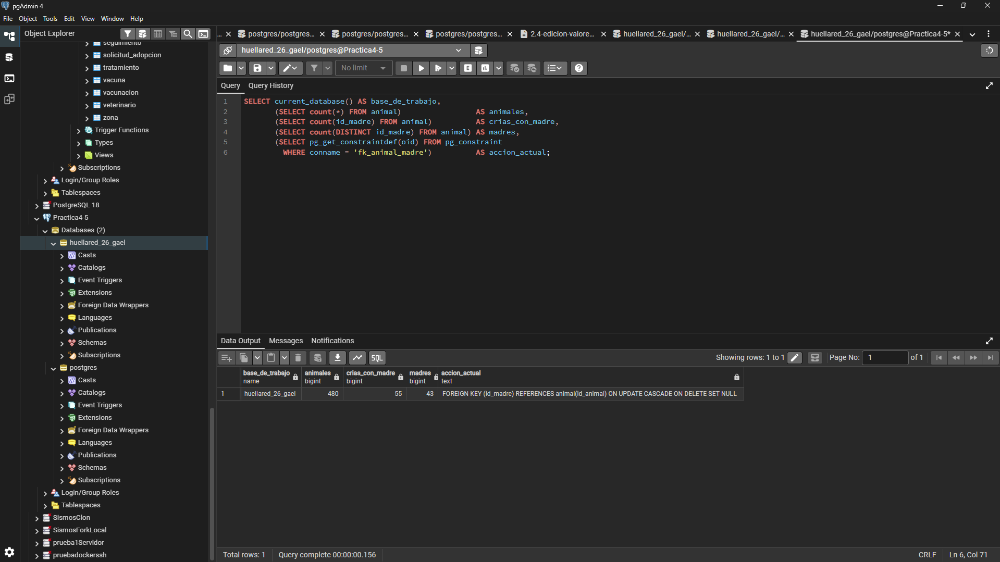
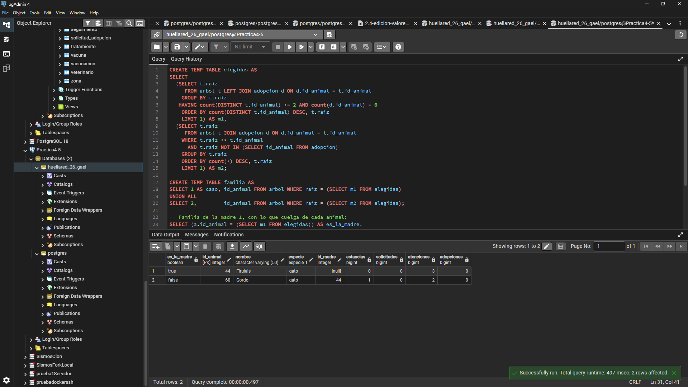
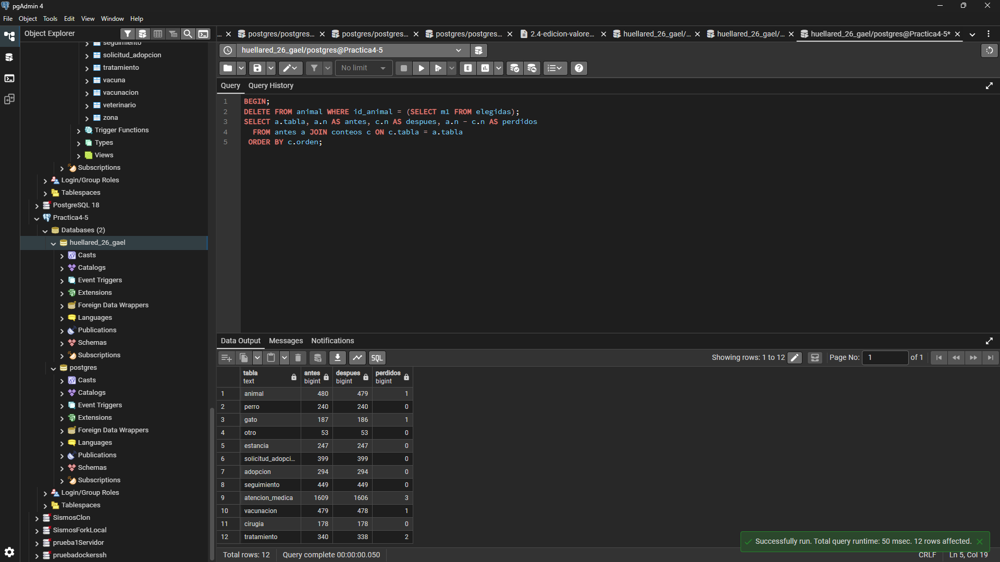
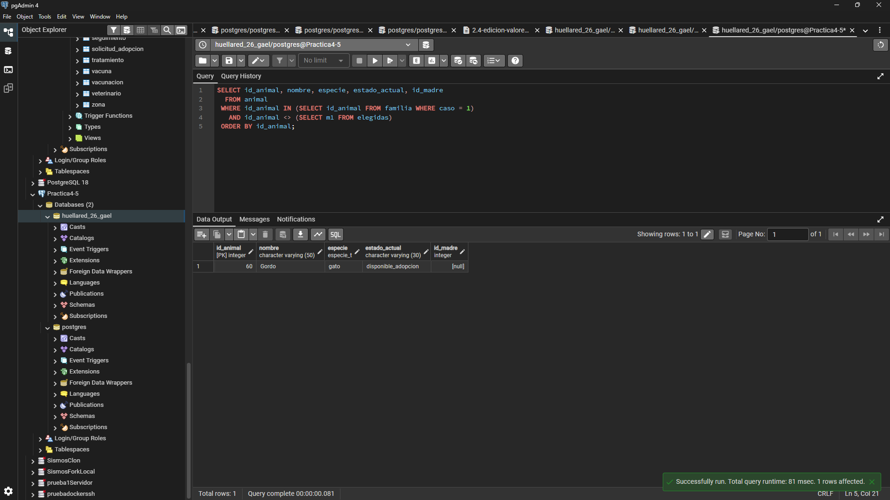
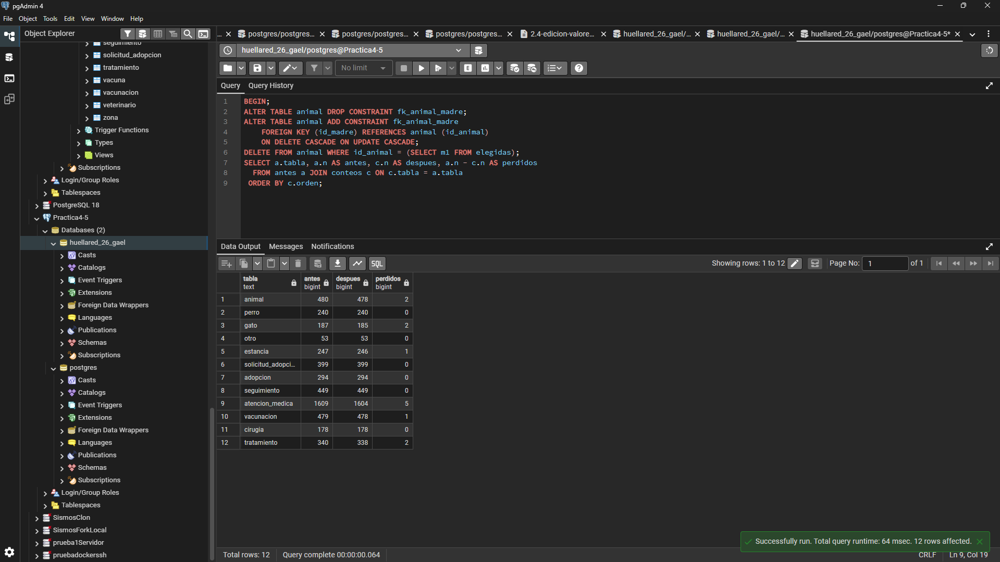
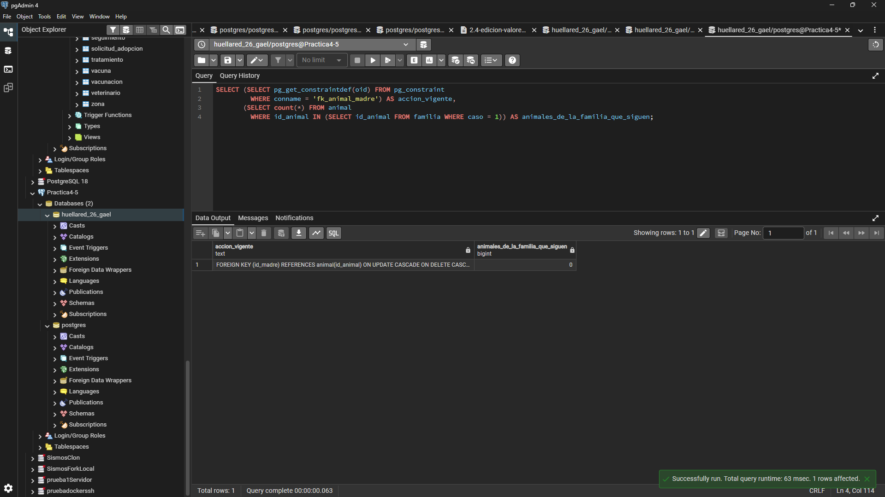
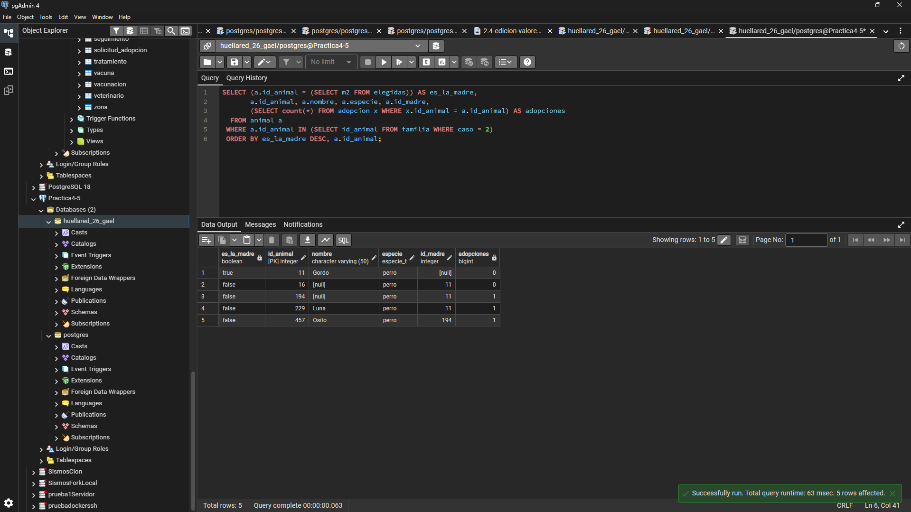
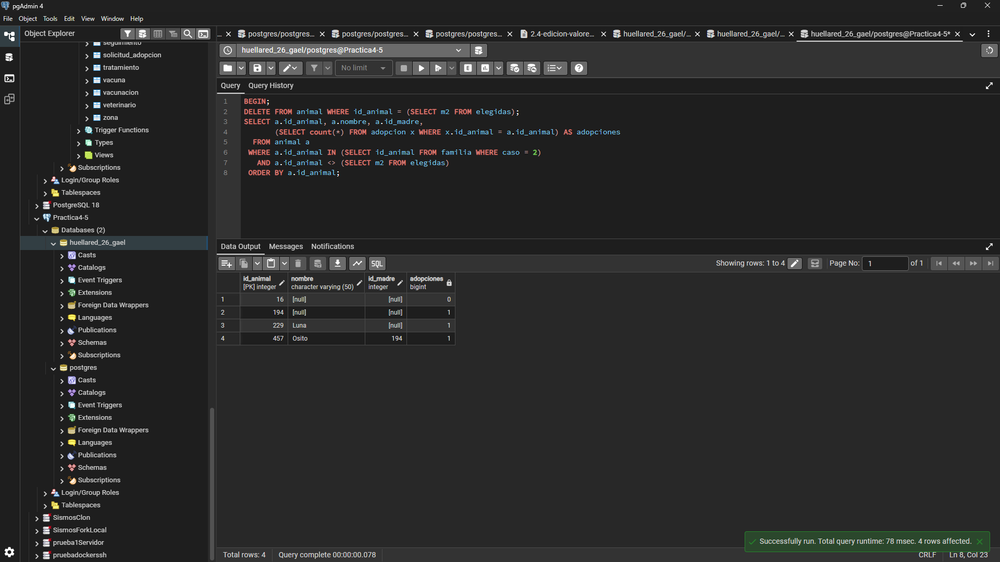
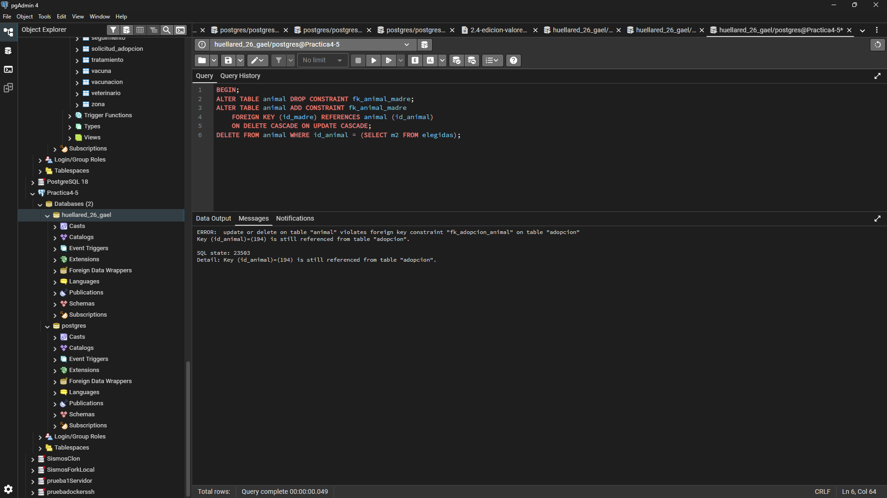
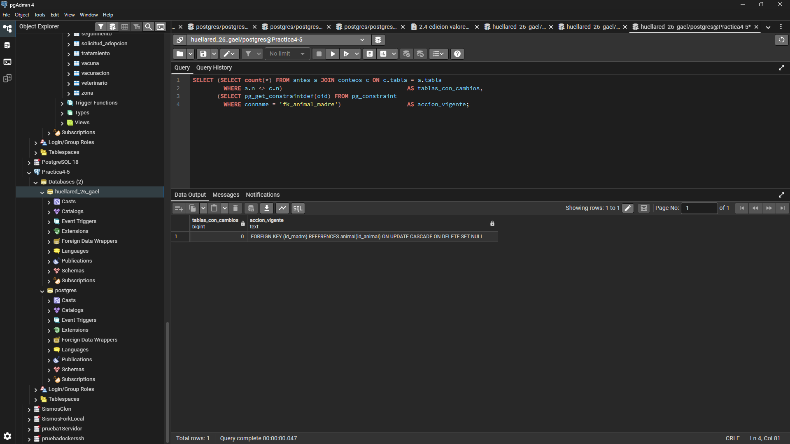

# Ejercicio 2.6 — Cambio de acción referencial

**Integrante:** Gael Armando Zamudio Monroy (`GaelZamudio`).  
**Proyecto propio:** HuellaRed. **Gestor:** PostgreSQL.  
**Script completo:** [GaelZamudio.sql](GaelZamudio.sql).  
**Base de prueba:** `huellared_26_gael`, copia de la base del proyecto propio.

## 1. Relación elegida y propósito

Se estudia la relación recursiva **es madre de**, correspondiente a la zona de rescate, animal y adopción. Tanto el registro padre como el hijo pertenecen a `animal`.

| Elemento | Definición |
|---|---|
| Clave foránea | `fk_animal_madre` |
| Columna que referencia a la madre | `animal.id_madre`, admite `NULL` |
| Clave referenciada | `animal.id_animal` |
| Acción original de borrado | `ON DELETE SET NULL` |
| Acción alternativa probada | `ON DELETE CASCADE` |
| Acción de actualización, conservada | `ON UPDATE CASCADE` |

En este experimento se compara `SET NULL` con `CASCADE`. La primera conserva las crías cuando se elimina el registro de su madre y deja su referencia en `NULL`. La segunda intenta eliminar también a las crías y, recursivamente, a sus descendientes. Esto puede activar otras acciones referenciales sobre sus estancias, atenciones y demás registros dependientes.

## 2. Preparación y método

Las pruebas se ejecutaron en pgAdmin sobre la copia `huellared_26_gael`, con datos sintéticos del generador del proyecto. La captura inicial muestra **480 animales**, **55 registros con madre vinculada** y **43 identificadores distintos de madre**, además de la acción original `SET NULL`.

```sql
SELECT current_database() AS base_de_trabajo,
       (SELECT count(*) FROM animal) AS animales,
       (SELECT count(id_madre) FROM animal) AS crias_con_madre,
       (SELECT count(DISTINCT id_madre) FROM animal) AS madres,
       (SELECT pg_get_constraintdef(oid) FROM pg_constraint
         WHERE conname = 'fk_animal_madre') AS accion_actual;
```

`pg_constraint` contiene las restricciones registradas en PostgreSQL; `conname` es su nombre y `pg_get_constraintdef` permite consultar su definición.



El script prepara un árbol de descendencia mediante una consulta recursiva y guarda los conteos iniciales de doce tablas. Después selecciona dos casos existentes en los datos:

- **Caso 1:** una madre con descendencia cuya familia no tiene registros de adopción. Permite medir los borrados que sí se completan.
- **Caso 2:** una madre sin registros de adopción, pero con descendientes que sí los tienen. Permite observar la interacción con `fk_adopcion_animal`, cuya acción es `RESTRICT`.

Los bloques se ejecutan por separado, en orden y en una misma sesión de Query Tool, con autocommit activado fuera de las transacciones explícitas. Las estructuras auxiliares son temporales y pertenecen a esa sesión. Cada experimento comienza con `BEGIN` y termina con `ROLLBACK`, de modo que la comparación parte de los mismos datos. En PostgreSQL también se revierte el cambio de la clave foránea realizado dentro de la transacción.

Para repetir el script desde el principio se utiliza una nueva sesión: las tablas temporales creadas en la sesión anterior ya no estarán presentes. La selección de casos requiere datos que cumplan ambas condiciones; las capturas documentan que existen en esta ejecución.

## 3. Caso 1: familia sin adopciones

La consulta seleccionó la madre **44, Firulais**, de especie `gato`, y su cría **60, Gordo**. La madre tiene tres atenciones médicas; la cría tiene dos atenciones y una estancia. Ninguno tiene adopciones ni solicitudes de adopción.



### 3.1. Resultado con SET NULL

La eliminación se ejecutó con la restricción original:

```sql
BEGIN;
DELETE FROM animal WHERE id_animal = (SELECT m1 FROM elegidas);
SELECT a.tabla, a.n AS antes, c.n AS despues, a.n - c.n AS perdidos
  FROM antes a JOIN conteos c ON c.tabla = a.tabla
 ORDER BY c.orden;
-- Consultar la cría superviviente antes de cerrar el experimento.
```

Se eliminó la madre y, por las otras claves foráneas del esquema, su fila en `gato`, sus tres atenciones, una vacunación y dos tratamientos. **La cría se conservó junto con sus registros asociados.**



La cría 60 permanece con estado `disponible_adopcion`, pero ahora `id_madre` es `NULL`.

```sql
SELECT id_animal, nombre, especie, estado_actual, id_madre
  FROM animal
 WHERE id_animal IN (SELECT id_animal FROM familia WHERE caso = 1)
   AND id_animal <> (SELECT m1 FROM elegidas)
 ORDER BY id_animal;
ROLLBACK;
```



### 3.2. Resultado con CASCADE

Después de revertir el experimento anterior, se cambió realmente la acción referencial dentro de una nueva transacción y se eliminó la misma madre:

```sql
BEGIN;
ALTER TABLE animal DROP CONSTRAINT fk_animal_madre;
ALTER TABLE animal ADD CONSTRAINT fk_animal_madre
    FOREIGN KEY (id_madre) REFERENCES animal (id_animal)
    ON DELETE CASCADE ON UPDATE CASCADE;
DELETE FROM animal WHERE id_animal = (SELECT m1 FROM elegidas);
SELECT a.tabla, a.n AS antes, c.n AS despues, a.n - c.n AS perdidos
  FROM antes a JOIN conteos c ON c.tabla = a.tabla
 ORDER BY c.orden;
```

Ahora se eliminaron **ambos animales**, sus dos filas de `gato`, la estancia de la cría y las cinco atenciones de la familia. Los conteos completos permiten comparar ambas acciones:

| Tabla | Inicial | Después de SET NULL | Después de CASCADE |
|---|---:|---:|---:|
| animal | 480 | 479 | 478 |
| perro | 240 | 240 | 240 |
| gato | 187 | 186 | 185 |
| otro | 53 | 53 | 53 |
| estancia | 247 | 247 | 246 |
| solicitud_adopcion | 399 | 399 | 399 |
| adopcion | 294 | 294 | 294 |
| seguimiento | 449 | 449 | 449 |
| atencion_medica | 1609 | 1606 | 1604 |
| vacunacion | 479 | 478 | 478 |
| cirugia | 178 | 178 | 178 |
| tratamiento | 340 | 338 | 338 |



La siguiente consulta muestra la definición vigente durante la prueba y **cero animales supervivientes de esa familia**. La celda de definición aparece recortada en la captura; el `ALTER TABLE` ejecutado se documenta en el script y en el bloque anterior.

```sql
SELECT (SELECT pg_get_constraintdef(oid) FROM pg_constraint
         WHERE conname = 'fk_animal_madre') AS accion_vigente,
       (SELECT count(*) FROM animal
         WHERE id_animal IN (SELECT id_animal FROM familia WHERE caso = 1))
         AS animales_de_la_familia_que_siguen;
ROLLBACK;
```



## 4. Caso 2: descendientes con adopciones

Se seleccionó el animal **11, Gordo**, sin adopciones registradas. Su descendencia incluye los animales **16, 194 y 229**, que referencian directamente al 11, y el **457, Osito**, cuya madre registrada es el 194. Los animales 194, 229 y 457 tienen una adopción cada uno.



### 4.1. SET NULL conserva descendientes y adopciones

Con la acción original se pudo borrar el registro 11. Las referencias de sus crías directas quedaron en `NULL`; el animal 457 mantuvo su referencia al 194 porque este último siguió existiendo. Las tres adopciones se conservaron.

```sql
BEGIN;
DELETE FROM animal WHERE id_animal = (SELECT m2 FROM elegidas);
SELECT a.id_animal, a.nombre, a.id_madre,
       (SELECT count(*) FROM adopcion x WHERE x.id_animal = a.id_animal)
         AS adopciones
  FROM animal a
 WHERE a.id_animal IN (SELECT id_animal FROM familia WHERE caso = 2)
   AND a.id_animal <> (SELECT m2 FROM elegidas)
 ORDER BY a.id_animal;
ROLLBACK;
```



### 4.2. CASCADE provoca un rechazo por RESTRICT

Tras restaurar los datos, se repitió el borrado con la acción alternativa:

```sql
BEGIN;
ALTER TABLE animal DROP CONSTRAINT fk_animal_madre;
ALTER TABLE animal ADD CONSTRAINT fk_animal_madre
    FOREIGN KEY (id_madre) REFERENCES animal (id_animal)
    ON DELETE CASCADE ON UPDATE CASCADE;
DELETE FROM animal WHERE id_animal = (SELECT m2 FROM elegidas);
```

La operación fue rechazada con **SQLSTATE `23503`**. El mensaje identifica la restricción **`fk_adopcion_animal`** y señala que el animal **194** todavía está referenciado desde `adopcion`.



`CASCADE` no anula las demás restricciones: al intentar borrar un descendiente protegido por `RESTRICT`, falla la sentencia completa. No se confirma un borrado parcial de la familia. Después del error se ejecutó, por separado:

```sql
ROLLBACK;
```

Esto cierra la transacción abortada y revierte también el cambio de acción referencial.

## 5. Comprobación final

```sql
SELECT (SELECT count(*) FROM antes a JOIN conteos c ON c.tabla = a.tabla
         WHERE a.n <> c.n) AS tablas_con_cambios,
       (SELECT pg_get_constraintdef(oid) FROM pg_constraint
         WHERE conname = 'fk_animal_madre') AS accion_vigente;
```

El resultado fue **`tablas_con_cambios = 0`** y la definición volvió a mostrar **`ON UPDATE CASCADE ON DELETE SET NULL`**. La comprobación verifica que las doce tablas supervisadas recuperaron sus conteos iniciales y que la acción original está vigente; no constituye por sí sola una comparación de todos los valores almacenados. Los experimentos se deshicieron mediante `ROLLBACK`.



## 6. Decisión para el dominio

**Conservo `ON DELETE SET NULL` para `fk_animal_madre`.** La existencia de una cría, su rescate, estancia, atención médica y adopción son independientes de que permanezca registrado el vínculo con su madre. El caso 1 demuestra que `CASCADE` podría eliminar una cría y su historial sin que exista una razón de negocio para hacerlo; el caso 2 demuestra que además puede impedir el borrado de la madre por las adopciones de sus descendientes.

La referencia a la madre es opcional y admite `NULL`, lo que hace posible esta acción. Sin embargo, la opcionalidad no obliga por sí sola a elegir `SET NULL`: la decisión se justifica por la independencia de los animales y la conservación de sus registros. La coexistencia de `CASCADE` y `RESTRICT` es técnicamente válida; el problema aquí es que el borrado de descendientes no corresponde al significado de la relación de parentesco.

`SET NULL` también tiene límites: se pierde el vínculo con la madre y no se distingue entre una madre desconocida y una cuyo registro fue borrado. Además, esta acción no protege el historial propio del animal que se elimina, como muestran las tres atenciones borradas en el primer caso. Si se requiere conservar todo el historial, conviene mantener el registro del animal. El estado `fallecido` solo debe usarse cuando haya ocurrido su fallecimiento; una función general de archivo o baja lógica requeriría una decisión adicional de diseño.

El cambio a `CASCADE` se realizó efectivamente en la copia para demostrar sus efectos, pero no se incorporó como migración permanente del proyecto.