# Pruebas de integridad referencial — HuellaRed

Ejercicio 2.3 · PostgreSQL 17.

## Ejecución y alcance

Primero completar el arranque del README: PostgreSQL saludable y servicios configurar/poblar terminados con código 0. En pgAdmin, conectar a HuellaRed como `huellared_admin` y ejecutar completo `sql/2.3-pruebas-referenciales.sql`. Los datos usados son los registros sintéticos persistidos por el generador, no datos personales o casos reales observados. Se requieren los datos cargados.

Cada escenario exitoso se revierte mediante SAVEPOINT/ROLLBACK TO. El ROLLBACK final retira todos los datos auxiliares. Los errores esperados se capturan en bloques EXCEPTION, que revierten la sentencia fallida y muestran el SQLSTATE, la restricción y el mensaje real en Messages. Un error distinto se propaga y no se presenta como prueba correcta. Si aparece un error inesperado, ejecutar ROLLBACK antes de continuar.

Se prueba cada acción usada: DELETE CASCADE, DELETE RESTRICT, DELETE SET NULL y UPDATE CASCADE. No se prueba SET DEFAULT porque ninguna FK del proyecto usa esa acción. Los conteos de la siguiente tabla proceden de la ejecución sobre la generación de 7,205 registros; pueden cambiar si se agregan datos.

## Resultados comprobados

| Caso | Antes | Después | Interpretación |
|---|---|---|---|
| DELETE CASCADE, adopción → seguimiento | 294 adopciones, 449 seguimientos | 293 adopciones, 446 seguimientos | Se eliminaron una adopción y sus tres seguimientos. |
| DELETE RESTRICT, animal con adopción | 480 animales, 294 adopciones | 480 animales, 294 adopciones | fk_adopcion_animal rechazó el borrado con 23503. |
| DELETE SET NULL, clínica → atención | 25 clínicas, 1,609 atenciones, 189 sin clínica | 24 clínicas, 1,609 atenciones, 257 sin clínica | Sobreviven las atenciones; 68 pierden la referencia opcional. |
| UPDATE CASCADE, zona → rescate | 94 zonas, 420 rescates, 9 referencias al ID anterior | 94 zonas, 420 rescates, 9 referencias al ID nuevo | Se propagó la corrección sin eliminar registros. |
| Hija antes que padre | Zona auxiliar inexistente | INSERT rechazado por fk_rescate_zona, 23503 | Una referencia no puede apuntar a una zona inexistente. |
| Padre antes que hija | Se inserta primero la zona auxiliar | Se inserta un rescate vinculado correctamente | Es el orden utilizado por el cargador. |

Mensajes reales observados:

```text
SQLSTATE 23503, fk_adopcion_animal: update or delete on table "animal" violates foreign key constraint "fk_adopcion_animal" on table "adopcion"
Hija antes que padre: SQLSTATE 23503, fk_rescate_zona: insert or update on table "rescate" violates foreign key constraint "fk_rescate_zona"
```

La comparación del contenido completo de las tablas antes y después confirmó que los ejercicios dejaron los datos originales intactos.

## Comprobaciones sobre las dos bases

Ejecutar `sql/2.3-auditoria-integridad.sql` por separado en HuellaRed y en la base asignada, con un usuario que pueda leer todas las tablas de public. La función temporal revisa las FK declaradas, las columnas NOT NULL, las PK, las restricciones UNIQUE y los índices únicos parciales (incluidas adopciones vigentes y estancias abiertas). Respeta la semántica de NULL de los índices únicos.

El primer resultado debe estar vacío. El segundo indica cuántas FK fueron cubiertas y si hay alguna pendiente de validar: un resultado vacío no demuestra relaciones que nunca fueron declaradas. Las FK opcionales con NULL no son huérfanas ni una infracción de NOT NULL.

En la validación realizada, HuellaRed devolvió cero infracciones, 29 FK y cero FK sin validar. La copia de los datos SQL originales de Sismos devolvió cero infracciones, 4 FK y cero FK sin validar. Esta comprobación corresponde al requisito de auditoría de ambas bases del ejercicio 2.3.

## Evidencias de ejecución

### DELETE CASCADE

Comparación antes y después del borrado de una adopción y sus seguimientos.

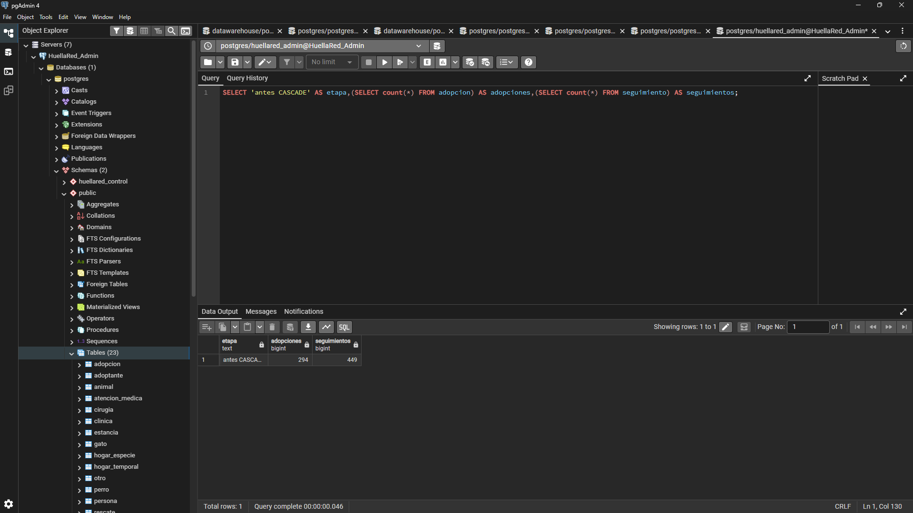

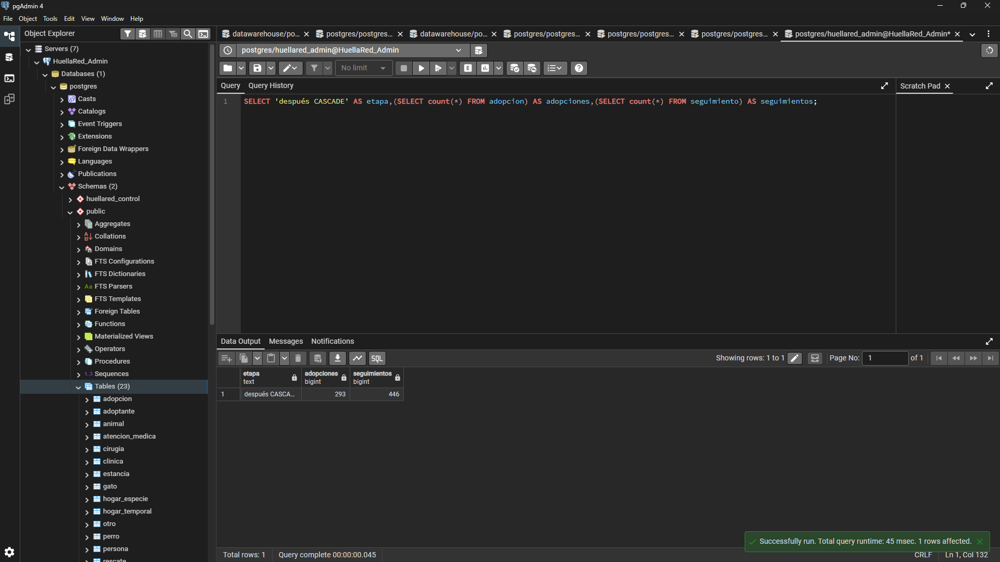

### DELETE RESTRICT

Secuencia del conteo inicial, rechazo por fk_adopcion_animal y conteo posterior sin cambios.

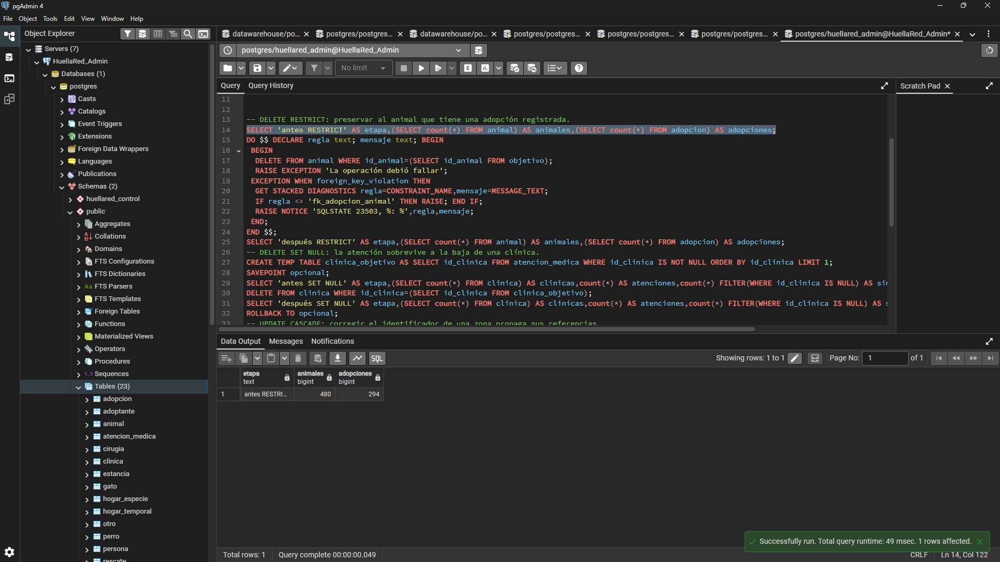

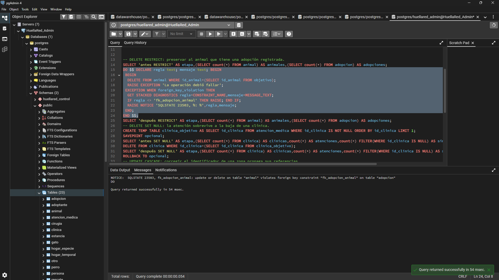

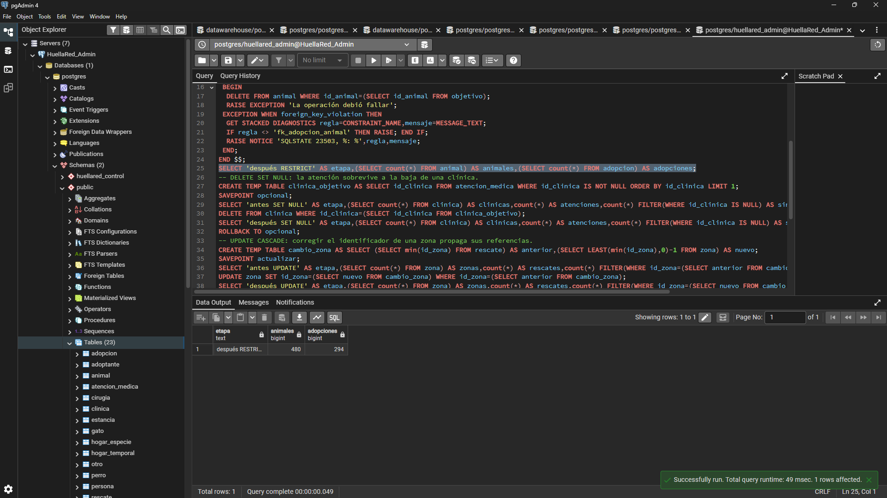

### DELETE SET NULL

Se conservan las atenciones médicas mientras se retira su referencia a la clínica eliminada.

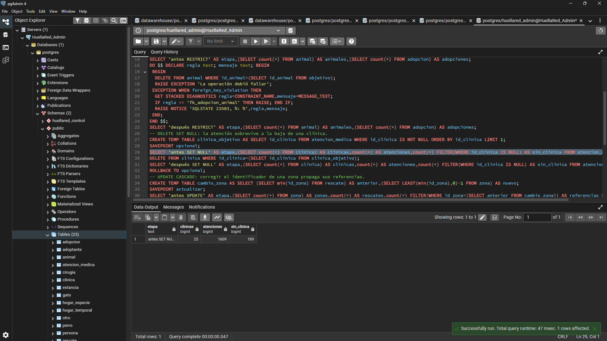

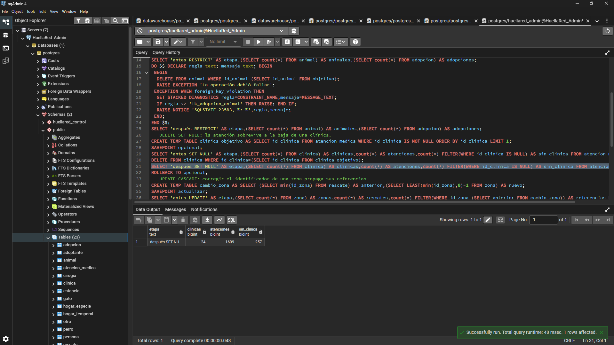

### UPDATE CASCADE

Los conteos se conservan y las referencias se propagan del identificador anterior al nuevo.

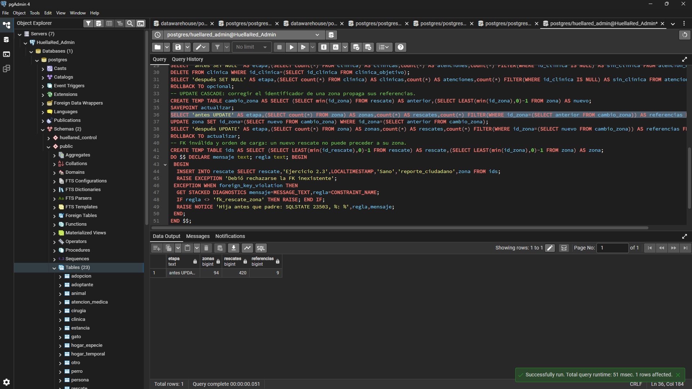

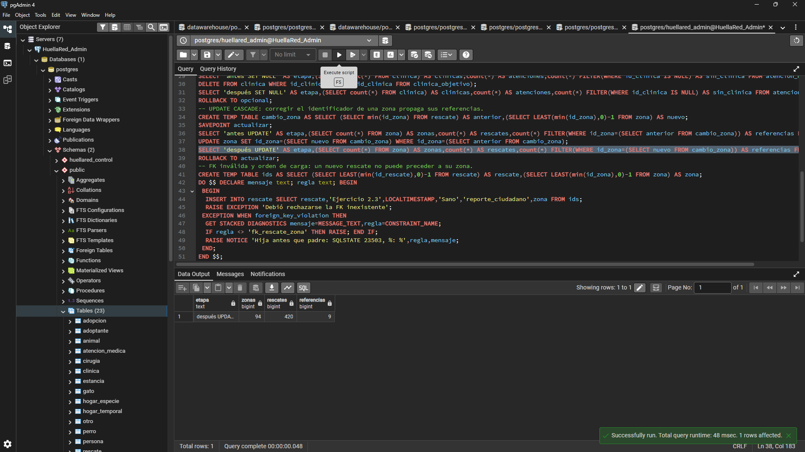

### Orden de carga

Primero se muestra el rechazo por insertar el rescate antes de su zona; después, la inserción correcta al crear primero la zona.

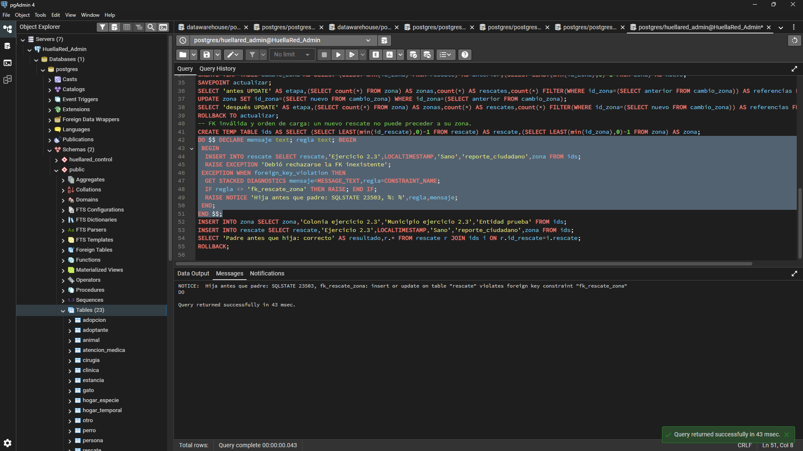

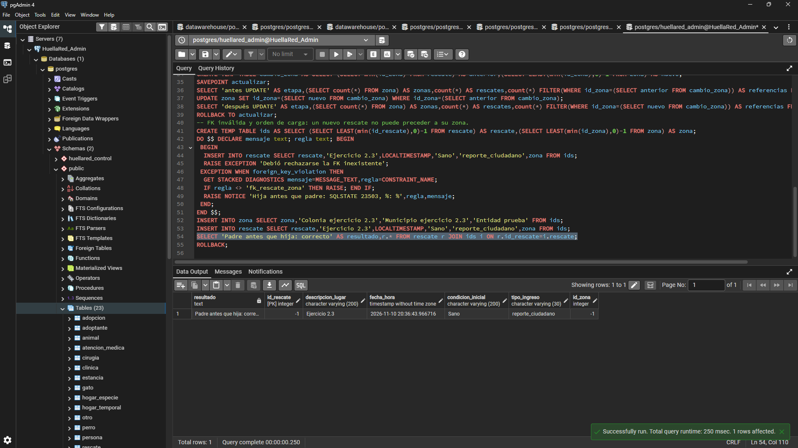

## SQL: 2.3-pruebas-referenciales.sql

```sql
-- Ejecutar completo en pgAdmin como huellared_admin, en HuellaRed poblada.
-- Los datos son sintéticos del generador; no se presentan como observaciones reales.
BEGIN;
SET LOCAL ROLE hr_admin;
CREATE TEMP TABLE objetivo AS SELECT id_animal,id_persona,fecha_adopcion FROM seguimiento ORDER BY id_animal LIMIT 1;
DO $$ BEGIN IF NOT EXISTS(SELECT FROM objetivo) THEN RAISE EXCEPTION 'Primero poblar HuellaRed'; END IF; END $$;
-- DELETE CASCADE: borrar una adopción elimina sus seguimientos dependientes.
SAVEPOINT cascada;
SELECT 'antes CASCADE' AS etapa,(SELECT count(*) FROM adopcion) AS adopciones,(SELECT count(*) FROM seguimiento) AS seguimientos;
DELETE FROM adopcion a USING objetivo o WHERE (a.id_animal,a.id_persona,a.fecha_adopcion)=(o.id_animal,o.id_persona,o.fecha_adopcion);
SELECT 'después CASCADE' AS etapa,(SELECT count(*) FROM adopcion) AS adopciones,(SELECT count(*) FROM seguimiento) AS seguimientos;
ROLLBACK TO cascada;
-- DELETE RESTRICT: preservar al animal que tiene una adopción registrada.
SELECT 'antes RESTRICT' AS etapa,(SELECT count(*) FROM animal) AS animales,(SELECT count(*) FROM adopcion) AS adopciones;
DO $$ DECLARE regla text; mensaje text; BEGIN
 BEGIN
  DELETE FROM animal WHERE id_animal=(SELECT id_animal FROM objetivo);
  RAISE EXCEPTION 'La operación debió fallar';
 EXCEPTION WHEN foreign_key_violation THEN
  GET STACKED DIAGNOSTICS regla=CONSTRAINT_NAME,mensaje=MESSAGE_TEXT;
  IF regla <> 'fk_adopcion_animal' THEN RAISE; END IF;
  RAISE NOTICE 'SQLSTATE 23503, %: %',regla,mensaje;
 END;
END $$;
SELECT 'después RESTRICT' AS etapa,(SELECT count(*) FROM animal) AS animales,(SELECT count(*) FROM adopcion) AS adopciones;
-- DELETE SET NULL: la atención sobrevive a la baja de una clínica.
CREATE TEMP TABLE clinica_objetivo AS SELECT id_clinica FROM atencion_medica WHERE id_clinica IS NOT NULL ORDER BY id_clinica LIMIT 1;
SAVEPOINT opcional;
SELECT 'antes SET NULL' AS etapa,(SELECT count(*) FROM clinica) AS clinicas,count(*) AS atenciones,count(*) FILTER(WHERE id_clinica IS NULL) AS sin_clinica FROM atencion_medica;
DELETE FROM clinica WHERE id_clinica=(SELECT id_clinica FROM clinica_objetivo);
SELECT 'después SET NULL' AS etapa,(SELECT count(*) FROM clinica) AS clinicas,count(*) AS atenciones,count(*) FILTER(WHERE id_clinica IS NULL) AS sin_clinica FROM atencion_medica;
ROLLBACK TO opcional;
-- UPDATE CASCADE: corregir el identificador de una zona propaga sus referencias.
CREATE TEMP TABLE cambio_zona AS SELECT (SELECT min(id_zona) FROM rescate) AS anterior,(SELECT LEAST(min(id_zona),0)-1 FROM zona) AS nuevo;
SAVEPOINT actualizar;
SELECT 'antes UPDATE' AS etapa,(SELECT count(*) FROM zona) AS zonas,count(*) AS rescates,count(*) FILTER(WHERE id_zona=(SELECT anterior FROM cambio_zona)) AS referencias FROM rescate;
UPDATE zona SET id_zona=(SELECT nuevo FROM cambio_zona) WHERE id_zona=(SELECT anterior FROM cambio_zona);
SELECT 'después UPDATE' AS etapa,(SELECT count(*) FROM zona) AS zonas,count(*) AS rescates,count(*) FILTER(WHERE id_zona=(SELECT nuevo FROM cambio_zona)) AS referencias FROM rescate;
ROLLBACK TO actualizar;
-- FK inválida y orden de carga: un nuevo rescate no puede preceder a su zona.
CREATE TEMP TABLE ids AS SELECT (SELECT LEAST(min(id_rescate),0)-1 FROM rescate) AS rescate,(SELECT LEAST(min(id_zona),0)-1 FROM zona) AS zona;
DO $$ DECLARE mensaje text; regla text; BEGIN
 BEGIN
  INSERT INTO rescate SELECT rescate,'Ejercicio 2.3',LOCALTIMESTAMP,'Sano','reporte_ciudadano',zona FROM ids;
  RAISE EXCEPTION 'Debió rechazarse la FK inexistente';
 EXCEPTION WHEN foreign_key_violation THEN
  GET STACKED DIAGNOSTICS mensaje=MESSAGE_TEXT,regla=CONSTRAINT_NAME;
  IF regla <> 'fk_rescate_zona' THEN RAISE; END IF;
  RAISE NOTICE 'Hija antes que padre: SQLSTATE 23503, %: %',regla,mensaje;
 END;
END $$;
INSERT INTO zona SELECT zona,'Colonia ejercicio 2.3','Municipio ejercicio 2.3','Entidad prueba' FROM ids;
INSERT INTO rescate SELECT rescate,'Ejercicio 2.3',LOCALTIMESTAMP,'Sano','reporte_ciudadano',zona FROM ids;
SELECT 'Padre antes que hija: correcto' AS resultado,r.* FROM rescate r JOIN ids i ON r.id_rescate=i.rescate;
ROLLBACK;
```

## SQL: 2.3-auditoria-integridad.sql

```sql
-- Ejecutar en CADA base como administrador/lector con acceso a todas las tablas public.
-- Solo lectura de tablas; la función auxiliar existe únicamente en esta sesión.
CREATE OR REPLACE FUNCTION pg_temp.auditar_integridad()
RETURNS TABLE(tipo text,objeto text,infracciones bigint) LANGUAGE plpgsql AS $$
DECLARE r record; condicion text; union_fk text; columnas text; filtro text;
BEGIN
 FOR r IN SELECT c.*, c.conrelid::regclass AS hija,c.confrelid::regclass AS padre
          FROM pg_constraint c JOIN pg_namespace n ON n.oid=c.connamespace
          WHERE c.contype='f' AND n.nspname='public' LOOP
  SELECT string_agg(format('h.%I IS NOT NULL',a.attname),' AND ' ORDER BY k.i),
         string_agg(format('h.%I=p.%I',a.attname,b.attname),' AND ' ORDER BY k.i)
  INTO condicion,union_fk
  FROM unnest(r.conkey,r.confkey) WITH ORDINALITY k(h,p,i)
  JOIN pg_attribute a ON a.attrelid=r.conrelid AND a.attnum=k.h
  JOIN pg_attribute b ON b.attrelid=r.confrelid AND b.attnum=k.p;
  RETURN QUERY EXECUTE format('SELECT %L::text,%L::text,count(*) FROM %s h WHERE %s AND NOT EXISTS(SELECT FROM %s p WHERE %s) HAVING count(*)>0',
    'FK huérfana',r.conname,r.hija,condicion,r.padre,union_fk);
 END LOOP;
 FOR r IN SELECT a.attname,c.oid::regclass AS tabla FROM pg_attribute a
 JOIN pg_class c ON c.oid=a.attrelid JOIN pg_namespace n ON n.oid=c.relnamespace
 WHERE n.nspname='public' AND c.relkind='r' AND a.attnum>0 AND NOT a.attisdropped AND a.attnotnull LOOP
  RETURN QUERY EXECUTE format('SELECT %L::text,%L::text,count(*) FROM %s WHERE %I IS NULL HAVING count(*)>0',
   'NULL prohibido',r.tabla||'.'||r.attname,r.tabla,r.attname);
 END LOOP;
 -- Incluye PK, UNIQUE e índices únicos parciales; respeta NULLS DISTINCT.
 FOR r IN SELECT i.*, i.indrelid::regclass AS tabla,i.indexrelid::regclass AS indice,
                 pg_get_expr(i.indpred,i.indrelid) AS predicado
          FROM pg_index i JOIN pg_class c ON c.oid=i.indrelid JOIN pg_namespace n ON n.oid=c.relnamespace
          WHERE n.nspname='public' AND i.indisunique LOOP
  SELECT string_agg(pg_get_indexdef(r.indexrelid,k,true),', '),
         string_agg('('||pg_get_indexdef(r.indexrelid,k,true)||') IS NOT NULL',' AND ')
  INTO columnas,filtro FROM generate_series(1,r.indnkeyatts) k;
  RETURN QUERY EXECUTE format('SELECT %L::text,%L::text,COALESCE(sum(n-1),0)::bigint FROM (SELECT count(*) n FROM %s WHERE (%s) AND (%s) GROUP BY %s HAVING count(*)>1) d HAVING COALESCE(sum(n-1),0)>0',
   'Duplicado único',r.indice,r.tabla,COALESCE(r.predicado,'true'),CASE WHEN r.indnullsnotdistinct THEN 'true' ELSE filtro END,columnas);
 END LOOP;
END $$;
SELECT * FROM pg_temp.auditar_integridad(); -- Debe devolver CERO FILAS.
-- Mostrar cobertura: un resultado vacío no prueba relaciones que no estén declaradas.
SELECT count(*) FILTER(WHERE contype='f') AS claves_foraneas,
       count(*) FILTER(WHERE contype='f' AND NOT convalidated) AS fk_sin_validar
FROM pg_constraint WHERE connamespace='public'::regnamespace;
```
